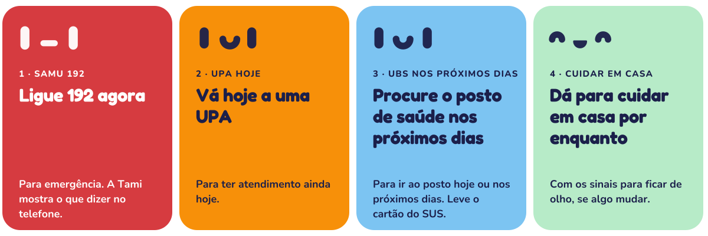
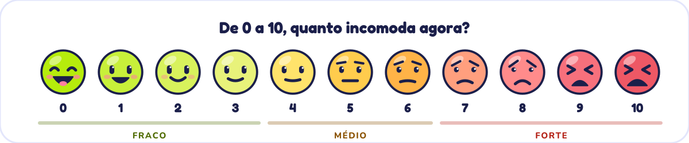
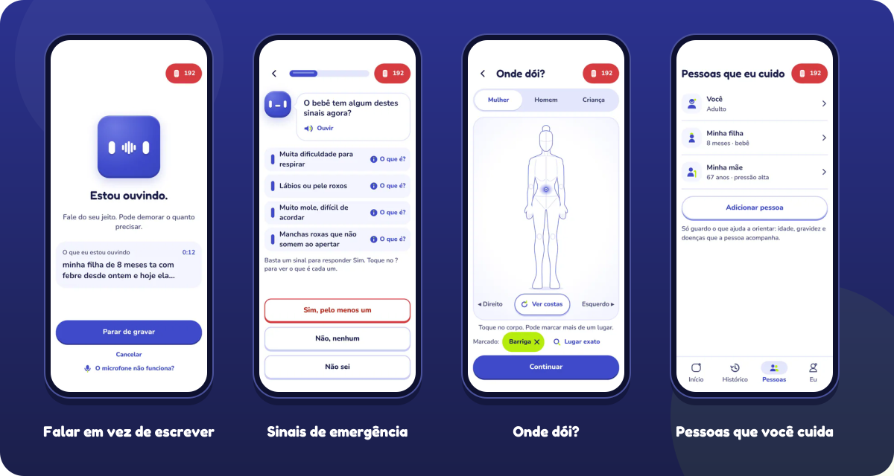
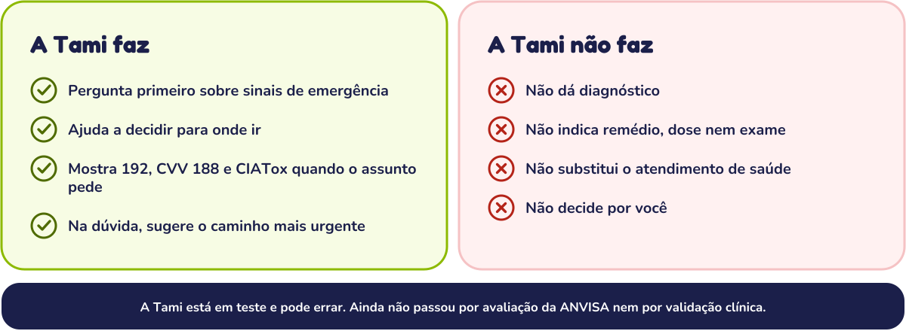
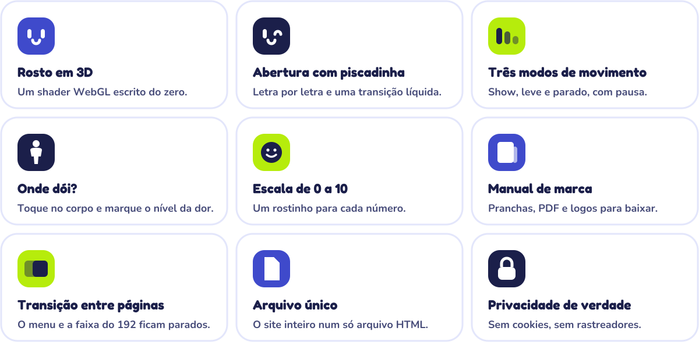
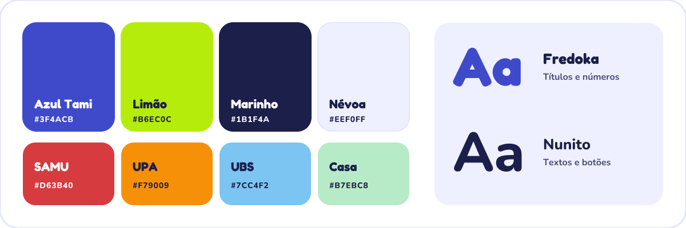
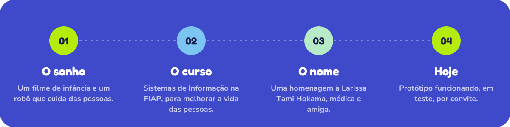

<div align="center">


<br>


<br>

<a href="https://tami-app.onrender.com/"></a>&nbsp;
<a href="https://gabriell230g.github.io/tami/"></a>&nbsp;
<a href="https://gabriell230g.github.io/tami/marca/"></a>&nbsp;
<a href="https://gabriell230g.github.io/tami/seguranca/"></a>&nbsp;
<a href="https://gabriell230g.github.io/tami/privacidade/"></a>

</div>

<br>

> [!IMPORTANT]
> A Tami **não é médica, não faz diagnóstico e não indica remédio**. Ela está em teste e pode errar.
> Ainda não passou por avaliação da ANVISA nem por validação clínica. **Em emergência, ligue 192.**

<div align="center">



</div>

## O que é a Tami

Na hora do susto, a dúvida quase sempre é a mesma: **para onde eu vou?** Chamar a ambulância, ir hoje a uma UPA, esperar o posto abrir ou cuidar em casa?

A Tami é um app que conversa com você em português simples, pergunta primeiro sobre os sinais de emergência e ajuda a escolher um destes quatro caminhos.

<div align="center">



</div>

## Como funciona

<div align="center">


<br><br>



</div>

<br>

- **Fale em vez de escrever.** A Tami mostra o que ouviu, e você confere antes de mandar.
- **Para quem você cuida.** Bebê, criança, adulto ou idoso.
- **Onde dói?** Toque no corpo e marque o nível da dor.
- **Um resumo para o atendimento.** O que você contou e o caminho sugerido. Sem diagnóstico.

## Por dentro do app

<div align="center">



</div>

## Segurança primeiro

<div align="center">



</div>

As orientações seguem **regras escritas a partir de materiais públicos de saúde**, como NHS, MedlinePlus e Ministério da Saúde. A Tami não usa inteligência artificial que inventa respostas. Na dúvida, ela sugere o caminho mais urgente.

## Teste o app

O app está aberto para um grupo pequeno de testadores. **[Abrir a Tami](https://tami-app.onrender.com/)**

> [!NOTE]
> O servidor gratuito dorme quando ninguém usa. Na primeira visita do dia ele pode levar até 1 minuto para acordar.

## Como o app funciona por dentro

Este repositório também guarda o **app** (pasta `app/`), feito para a Global Solution da FIAP (CitizenTech, 2º semestre de 2026).

| Parte | Como é feito |
| --- | --- |
| Servidor | Java 17 puro, com o servidor HTTP que já vem no Java. Sem framework |
| Motor de regras | Decide a próxima pergunta e o destino. Regras escritas a partir do NHS, MedlinePlus e Ministério da Saúde |
| Árvore do corpo | 38 regiões ligadas umas às outras. Escreveu "braço": a busca cai de 1.169 sinais para cerca de 100 |
| Banco de dados | PostgreSQL (Supabase) ou Oracle, com JDBC, DAOs e transações. 11 tabelas |
| Telas | HTML, CSS e JavaScript puro, sem biblioteca |
| Estatística | Intervalo de confiança de Wilson, kappa de Cohen, qui-quadrado, correlação de Pearson e matriz de confusão |

O motor foi testado com **10.000 casos escritos de propósito com armadilhas** (erro de digitação, negação, texto vago, sintoma no passado). O painel do app mostra os resultados.

<details>
<summary><b>Rodar o app no seu computador</b></summary>
<br>

Precisa do Java 17 ou mais novo.

```bash
cd app
cp tami.properties.exemplo tami.properties   # sem mudar nada, usa um banco local (H2)
./scripts/rodar.sh                           # no Windows: scripts
odar.bat
# abra http://localhost:8080
```

Para usar o Supabase ou o Oracle, troque a conexão no `tami.properties`. Esse arquivo fica fora do Git: a senha nunca vai para o repositório.

</details>

<details>
<summary><b>Publicar o app (Render)</b></summary>
<br>

O arquivo `render.yaml` já descreve tudo. No Render: **New ➜ Blueprint ➜ este repositório**, e preencha só a senha do banco (`TAMI_DB_SENHA`).

</details>

## O site

A pasta `site/` guarda o site de divulgação da Tami. Ele é feito à mão, sem framework e sem biblioteca de JavaScript.

<div align="center">



</div>

<details>
<summary><b>Os três modos de movimento</b></summary>
<br>

| Modo | Quando entra | O que acontece |
| --- | --- | --- |
| `show` | Aparelho com folga de memória e processador | Rosto em 3D, bolhas e céu que muda por seção |
| `leve` | Aparelho mais simples, rede lenta ou economia de dados | Rosto em 2D e animações curtas |
| `parado` | Botão "Pausar movimento" ou sistema com menos movimento | Nada se mexe. Tudo continua legível |

Para testar um modo: `?modo=show`, `?modo=leve` ou `?modo=parado`. Para pular a abertura: `?intro=nao`.

</details>

<details>
<summary><b>Rodar no seu computador</b></summary>
<br>

```bash
# 1. gerar o site a partir dos textos
cd site
python3 gen/site2.py

# 2. gerar o PDF e os logos do manual de marca
python3 gen/manual_pdf.py

# 3. conferir regras de texto, links e acessibilidade
python3 gen/checar_site.py
python3 gen/checar_site.py --visual

# 4. abrir no navegador
python3 -m http.server 8790 -d dist
```

Todos os textos do site ficam em `textos.csv` (página ➜ seção ➜ elemento ➜ texto). Mudou o texto, gera de novo.

</details>

<details>
<summary><b>Como as pastas estão organizadas</b></summary>
<br>

```
tami/
├── app/                o app (Java, banco, telas, testes)
│   ├── src/            motor de regras, DAOs, API
│   ├── web/            telas do app
│   └── sql/            scripts do Oracle e do PostgreSQL
├── render.yaml         publicação do app
└── site/
    ├── textos.csv      todos os textos do site
    ├── gen/
    │   ├── site2.py        gera as páginas
    │   ├── manual.py       manual de marca (pranchas)
    │   ├── manual_pdf.py   PDF e logos do manual
    │   ├── unico_site.py   o site inteiro num arquivo só
    │   ├── checar_site.py  regras de texto, links e tela
    │   ├── readme.py       este README e as artes
    │   └── assets/         CSS, JavaScript e o shader WebGL
    └── dist/               o site pronto para publicar
```

</details>

## A marca

<div align="center">



</div>

O manual completo, com logos para baixar, está em **[gabriell230g.github.io/tami/marca/](https://gabriell230g.github.io/tami/marca/)**.

## A história

<div align="center">



</div>

Desde criança, o meu filme favorito tem um robô enfermeiro que escuta, pergunta e cuida de quem está por perto. Eu sempre quis que existisse algo assim de verdade. Escolhi Sistemas de Informação para melhorar a vida das pessoas, e a Tami é o meu jeito de começar.

O nome é uma homenagem à minha amiga **Larissa Tami Hokama**, médica, que está me ajudando no projeto. A ajuda dela não é uma validação clínica: a revisão das regras por profissionais de saúde ainda vai acontecer.

<sub>A Tami é um projeto independente, sem ligação com a Disney ou com o filme.</sub>

## Privacidade

O site **não usa cookies, rastreadores nem ferramentas de análise**. As fontes, as imagens e os códigos ficam no próprio site. A política completa, com o que o app guarda e por quê, está em **[Privacidade](https://gabriell230g.github.io/tami/privacidade/)**.

## Licenças

| Item | Licença |
| --- | --- |
| Fredoka e Nunito (fontes) | SIL Open Font License 1.1 |
| Driver JDBC do PostgreSQL | BSD 2-Clause |
| Banco H2 (testes locais) | MPL 2.0 ou EPL 1.0 |
| Código, textos e marca da Tami | Projeto Tami. Todos os direitos reservados |

O site não usa nenhuma biblioteca de JavaScript de terceiros. O 3D é um shader WebGL escrito do zero.

## Quem faz

**Gabriel Gomes**, estudante de Sistemas de Informação da FIAP, em São Paulo.

<a href="https://www.linkedin.com/in/gabrielvasconcellosgomes"></a>

<br>

<div align="center">


</div>
